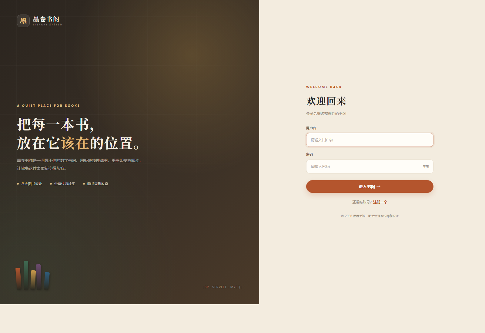
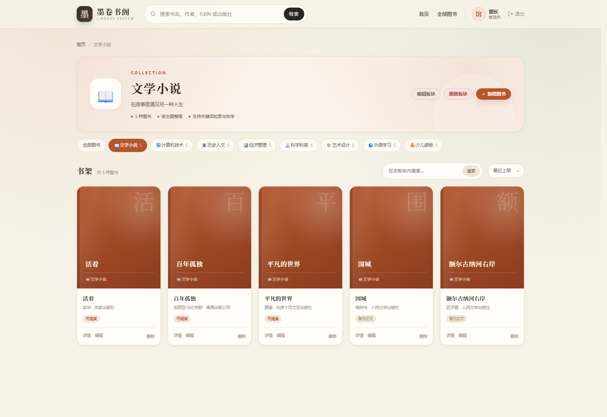
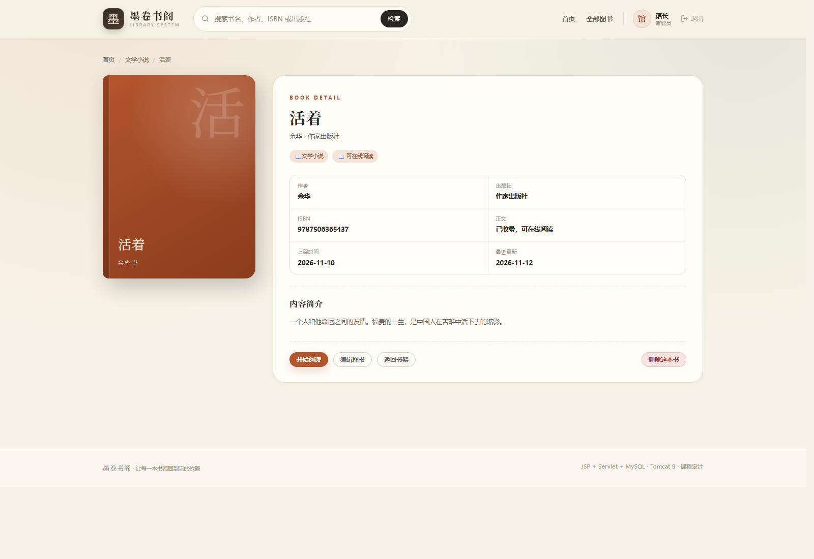
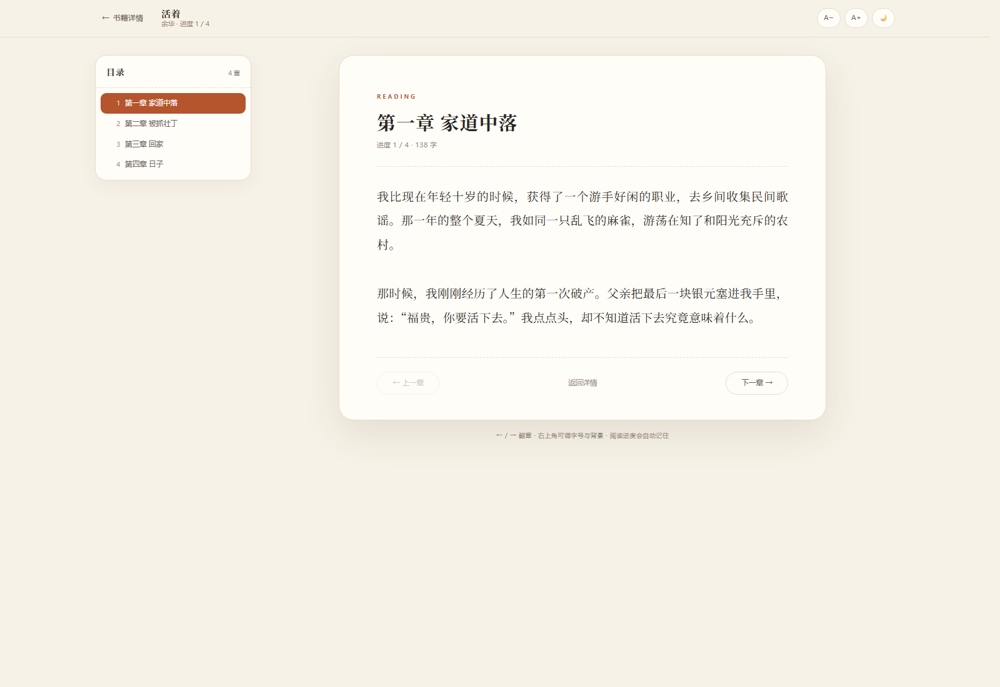
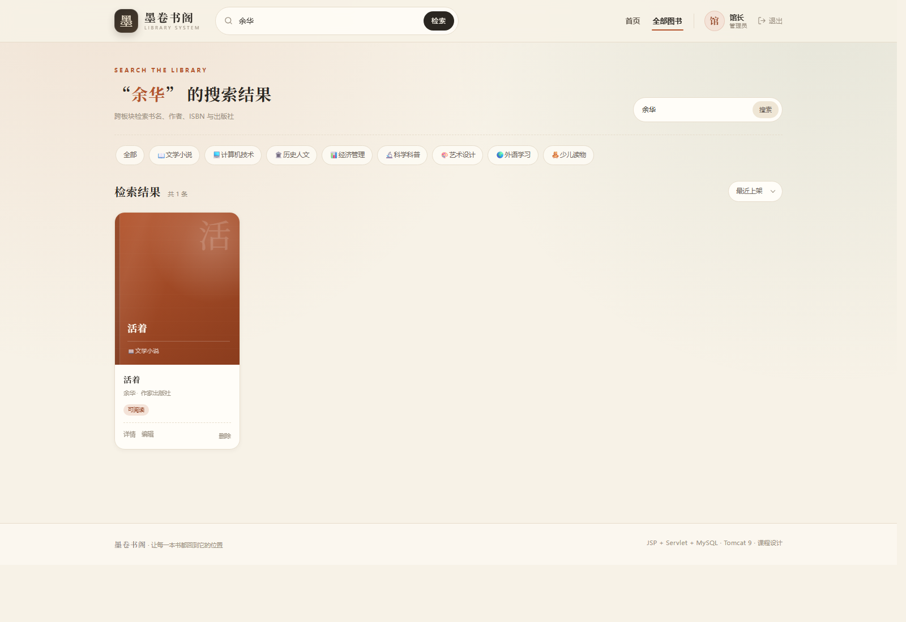

# 墨卷书阁 · 图书管理系统（Students Library System）

一个用 **JSP + Servlet + JDBC + MySQL** 实现的图书管理系统，按 **图书板块 → 书架 → 图书** 三层组织藏书。包含用户注册登录、板块管理、图书增删改查、全馆搜索、排序与分页，并支持上传 TXT 正文后在网页内分章阅读。

> 课程设计项目 · 可直接在 IntelliJ IDEA 中配合 Tomcat 9 运行。

---

## 界面预览

### 登录页


### 主页：图书板块


### 板块书架


### 图书详情


### 在线阅读


### 全馆搜索


### 新建板块


---

## 功能一览

| 模块 | 功能 |
| --- | --- |
| 用户 | 注册、登录、退出、PBKDF2 加盐密码、登录拦截 |
| 主页 | 欢迎语、馆藏统计、图书板块卡片 |
| 板块 | 新建、编辑、删除板块，自定义 emoji 图标与主题色 |
| 书架 | 点击板块进入对应书架，只显示本板块图书 |
| 图书 | 新增、详情、编辑、删除，ISBN、出版社、简介 |
| 阅读 | 上传 TXT 正文，自动识别编码、按章节切分，在线阅读 |
| 搜索 | 按书名、作者、ISBN、出版社跨板块搜索 |
| 排序 | 最近上架、最早上架、书名 |
| 分页 | 每页 12 条，上一页 / 下一页 |
| 安全 | PreparedStatement 防 SQL 注入、JSTL 转义防 XSS、Session 登录校验、HttpOnly Cookie |

---

## 技术栈

- Java 17（实测 JDK 25 也可运行）
- JSP 2.3 / Servlet 4.0（`javax.servlet`，对应 **Tomcat 9**）
- JSTL 1.2
- MySQL 8.0 + mysql-connector-java 8.0.30
- 原生 JDBC + DAO 分层，不依赖 Spring / Maven
- IntelliJ IDEA 传统 Web 工程（WebContent + artifact exploded war）

> 注意：本项目使用 `javax.servlet`，请使用 **Tomcat 9.x**。Tomcat 10+ 改成了 `jakarta.servlet`，直接部署会报 `ClassNotFoundException`。

---

## 目录结构

```text
jspsweb/
├── src/
│   ├── db.properties                 # 数据库连接配置（改这里）
│   └── com/library/
│       ├── entity/                   # User / Category / Book / Page / Chapter
│       ├── dao/                      # UserDao / CategoryDao / BookDao
│       ├── servlet/                  # Auth / Home / Category / Book / Search / Read
│       ├── filter/                   # EncodingFilter / AuthFilter
│       └── util/                     # DBUtil / PasswordUtil / WebUtil / BookContentStore / TxtBookParser
├── WebContent/
│   ├── login.jsp                     # 登录
│   ├── register.jsp                  # 注册
│   ├── index.jsp                     # 入口跳转
│   ├── error.jsp                     # 错误页
│   ├── assets/css/app.css            # 全部手写样式
│   ├── assets/js/app.js              # 交互脚本
│   ├── assets/js/reader.js           # 阅读页交互
│   └── WEB-INF/
│       ├── web.xml                   # Servlet / Filter 注册
│       ├── views/                    # 登录后的页面（不可直接访问）
│       │   ├── home.jsp
│       │   ├── shelf.jsp
│       │   ├── search.jsp
│       │   ├── book-form.jsp
│       │   ├── book-detail.jsp
│       │   ├── reader.jsp            # 在线阅读
│       │   ├── category-form.jsp
│       │   └── common/               # header / footer / 图书卡片
│       └── lib/
│           ├── jstl-1.2.jar
│           └── mysql-connector-java-8.0.30.jar
├── sql/library_db.sql                # 建库、建表、示例数据
├── sql/upgrade_reading.sql           # 已有数据库的在线阅读字段升级
├── lib/servlet-api.jar               # 仅编译用，不会打进 war
├── .idea/                            # IDEA 工程配置
├── jspsweb.iml
└── README.md
```

---

## 快速开始

### 1. 初始化数据库

确保本机 MySQL 8.0 已启动。用 **root** 执行：

```bash
mysql -uroot -p --default-character-set=utf8mb4 < sql/library_db.sql
```

脚本会：

1. 创建数据库 `library_db`（utf8mb4）；
2. 创建 `users`、`category`、`book` 三张表；
3. 写入 8 个板块、40 本示例图书、2 个账号；
4. 创建项目专用账号 `library_app`，密码 `123456`，只授予 `library_db` 权限。

**如果数据库已经建过、不想丢数据**，不要重新执行上面的脚本，只执行升级脚本即可：

```bash
mysql -uroot -p --default-character-set=utf8mb4 < sql/upgrade_reading.sql
```

它只会给 `book` 表补上 `content_file`、`content_name` 两列，可重复执行。

> 如果不想创建专用账号，也可以删掉脚本末尾的 `CREATE USER / GRANT` 语句，然后把自己的账号密码填进 `src/db.properties`。

### 2. 配置数据库连接

编辑 `src/db.properties`：

```properties
jdbc.url=jdbc:mysql://localhost:3306/library_db?useUnicode=true&characterEncoding=utf8&useSSL=false&allowPublicKeyRetrieval=true&serverTimezone=Asia/Shanghai
jdbc.username=library_app
jdbc.password=123456
```

也可以用环境变量覆盖，不必改文件：

```text
LIBRARY_JDBC_URL / LIBRARY_JDBC_USERNAME / LIBRARY_JDBC_PASSWORD
```

### 3. 在 IDEA 中运行

1. 用 IDEA 打开 `jspsweb` 目录；
2. `File → Project Structure → Project SDK` 选择 JDK 17 或以上；
3. 确认 `Tomcat 9.0.30` 已在 `Settings → Build, Execution, Deployment → Application Servers` 中配置；
4. 右上角运行配置选择 **Tomcat 9.0.30**，直接启动；
5. 浏览器访问：<http://localhost:8080/library/>。

IDEA 已配置好：

- Web 根目录：`WebContent`（不是空的 `web` 目录）；
- artifact：`jspsweb:Web exploded`；
- 部署上下文：`/library`；
- 编译级别：Java 17；
- `lib/servlet-api.jar` 用于编译，不会部署到 `WEB-INF/lib`。

> `.idea/workspace.xml` 含本机路径，未提交到 GitHub。从仓库克隆后，在 IDEA 里新增一个 **Tomcat 9** 运行配置，部署 `jspsweb:Web exploded`，上下文设为 `/library` 即可。

### 4. 演示账号

| 账号 | 密码 | 角色 |
| --- | --- | --- |
| `admin` | `admin123` | 管理员 |
| `demo` | `demo123` | 读者 |

也可以直接在注册页创建新账号。

---

## 页面与路由

| 路径 | 说明 |
| --- | --- |
| `/login.jsp` | 登录页 |
| `/register.jsp` | 注册页 |
| `POST /auth` | `action=login` 登录，`action=register` 注册 |
| `/auth?action=logout` | 退出登录 |
| `/home` | 登录后主页（板块总览 + 馆藏统计） |
| `/category?id=1` | 进入某个板块的书架 |
| `/category?action=toAdd` | 新建板块 |
| `/category?action=toEdit&id=1` | 编辑板块 |
| `POST /category` | `action=save` 保存板块，`action=delete` 删除 |
| `/book?action=toAdd&categoryId=1` | 新增图书 |
| `/book?action=toEdit&id=1` | 编辑图书（含正文 TXT 上传） |
| `/book?action=detail&id=1` | 图书详情 |
| `/read?id=1&chapter=0` | 在线阅读（章节从 0 开始） |
| `POST /book` | `action=save` 保存图书，`action=delete` 删除 |
| `/search?keyword=Java` | 全馆搜索 |

---

## 在线阅读使用说明

1. 进入任意图书的 **编辑图书** 页面；
2. 在「正文 TXT」处选择下载好的 `.txt` 文件，保存；
3. 回到图书详情页，点击 **开始阅读**，会自动按章节切分并显示目录；
4. 阅读页支持：上一章 / 下一章、键盘 ← → 翻章、目录抽屉、字号调节、纸白 / 护眼 / 夜间三种背景，阅读进度自动保存在浏览器里。

也可以不使用上传，直接把 TXT 放到正文目录：

```text
C:\Users\你的用户名\library-books
```

然后在编辑页的「或使用正文目录中的文件」里填写文件名（例如 `活着.txt`）即可。
正文目录可以用环境变量 `LIBRARY_BOOK_DIR` 或 JVM 参数 `-Dlibrary.book.dir=...` 修改。

- 支持 UTF-8、UTF-16（带 BOM）与 GBK/GB18030 编码；
- 单个文件最大 20MB；
- 章节标题支持 `第一章`、`第 1 回`、`序章`、`番外`、`Chapter 1` 等常见写法；没有章节标题的 TXT 会按长度自动分节。

---

## 演示账号

| 账号 | 密码 | 角色 |
| --- | --- | --- |
| `admin` | `admin123` | 管理员 |
| `demo` | `demo123` | 读者 |

> 登录页不再展示演示账号提示，账号仍然保留在数据库里，方便本地调试。

---

## 这次修好的环境问题

原工程能打开但基本跑不起来，已修复：

| 问题 | 修复 |
| --- | --- |
| `Book.java` 是空类，`BookDao` / `BookServlet` 无法编译 | 补全实体字段、getter/setter |
| `jspsweb.iml` 的 Web 根目录指向空的 `web/`，页面实际在 `WebContent/` | Web root 改为 `WebContent` |
| 运行配置部署路径是 `/jspsweb_Web_exploded` | 改为 `/library`，启动页指向 `/library/` |
| 只靠 `@WebServlet` 注解，旧版 Tomcat 9.0.30 配合 JDK 25 时注解扫描可能读不懂高版本 class 文件 | 改为 `web.xml` 显式注册，并设置 `metadata-complete="true"` |
| JSP 需要 JSTL，但 `WEB-INF/lib` 只有 MySQL 驱动 | 加入 `jstl-1.2.jar`，并配置 IDEA 库 |
| 项目 JDK 是 25，源码却混入了 Java 25 的 `Main.java` 示例 | 删除示例类，统一编译级别为 Java 17 |
| 中文表单/页面可能乱码 | `EncodingFilter` + JSP `page-encoding=UTF-8` + 数据库 utf8mb4 |
| `db.properties` 直接写 root 密码 | 改为专用账号，可用环境变量覆盖 |

> Tomcat 9.0.30 实测可以在 JDK 25 上启动并编译 JSP；真正需要注意的是 **Servlet 注解扫描** 和 **Jakarta 命名空间**。本项目已通过 `web.xml` 注册规避前者，通过固定 Tomcat 9 规避后者。

---

## 数据库设计

```text
users                          category
┌───────────────┐             ┌───────────────┐
│ id            │             │ id            │
│ username      │             │ name          │
│ password      │             │ icon          │
│ nickname      │             │ description   │
│ email         │             │ color         │
│ role          │             │ sort_order    │
│ created_at    │             │ created_at    │
└───────────────┘             └───────┬───────┘
                                      │ 1
                                      │
                                      │ N
                              ┌───────▼───────┐
                              │ book          │
                              │ id            │
                              │ category_id   │
                              │ name          │
                              │ author        │
                              │ isbn          │
                              │ publisher     │
                              │ description   │
                              │ content_file  │
                              │ content_name  │
                              │ create_time   │
                              │ update_time   │
                              └───────────────┘
```

- `book.category_id` 外键关联 `category.id`，`ON DELETE CASCADE`：删除板块会连带删除板块内图书。
- `content_file` 保存正文 TXT 在正文目录中的文件名，`content_name` 保存上传时的原始文件名。
- 密码字段保存 `pbkdf2_sha256$迭代次数$盐$哈希`，不保存明文。
- 所有 SQL 使用 `PreparedStatement`；排序字段走白名单，不拼接用户输入。

---

## 常用命令

```bash
# 导入数据库
mysql -uroot -p --default-character-set=utf8mb4 < sql/library_db.sql

# 重新生成一个密码哈希（可选）
javac -encoding UTF-8 -d out/production/jspsweb src/com/library/util/PasswordUtil.java
java -cp out/production/jspsweb com.library.util.PasswordUtil 你的新密码
```

---

## 已知限制

- 这是课程设计项目，未接入连接池（每次请求新建连接），高并发场景应改用 HikariCP/Druid。
- 所有登录用户都可以管理板块和图书，没有按角色细分权限。
- 删除操作使用 `confirm` 二次确认，没有回收站。
- 未实现借阅/归还记录，图书只用于展示与在线阅读，不涉及库存和价格。
- 阅读进度、字号与背景保存在浏览器 `localStorage`，换浏览器或清理缓存后会丢失。
- 在线阅读会一次性读取整个 TXT，超过 32MB 的文件暂不支持。

---

## 仓库

GitHub：<https://github.com/The7wa/Students_Library_System>

如果这个项目对你有帮助，欢迎点一个 Star ⭐。
